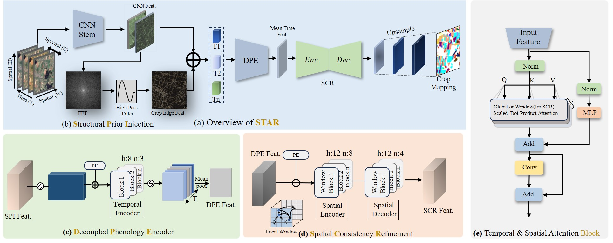
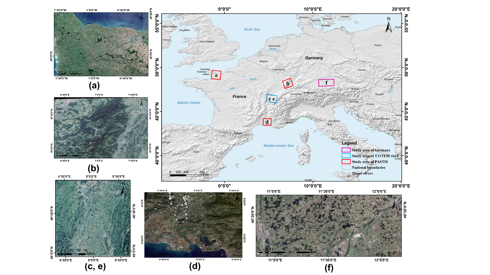
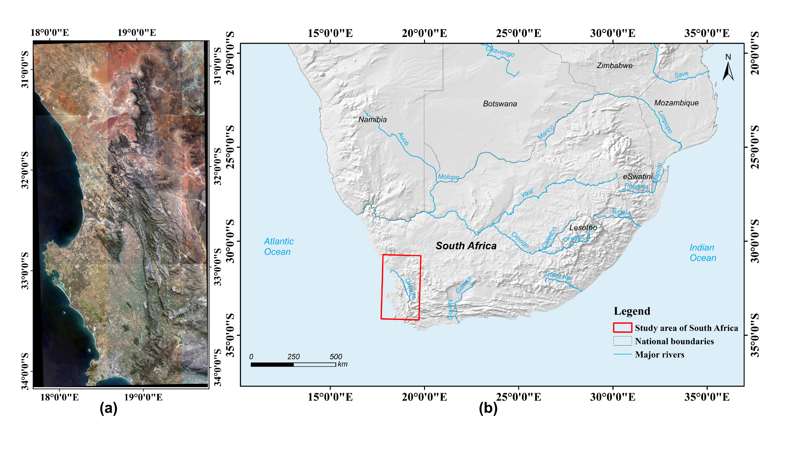
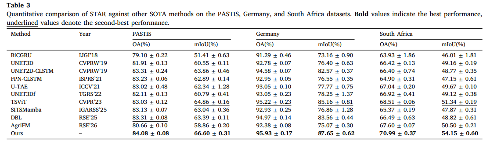

# STAR

Official PyTorch implementation of **Sketch and paint: A structural-temporal
aware refinement network for fine-grained crop mapping on satellite image
time series**, ISPRS Journal of Photogrammetry and Remote Sensing, 2026.
[Paper](https://doi.org/10.1016/j.isprsjprs.2026.09.009).

## Framework



## Datasets

| Dataset | Download | Expected format |
|---|---|---|
| PASTIS (France) | [PASTIS24](https://drive.google.com/drive/folders/1Lm0repzD_1NVcECsrwF8Q3bP2XEp2a0y) · [Original PASTIS](https://zenodo.org/records/5012942) | `pickle24x24/` |
| MTLCC (Germany) | [Zenodo](https://zenodo.org/records/5712933) | `data_IJGI18/datasets/full/240pkl/data16/` |
| South Africa | [Source Cooperative](https://source.coop/radiantearth/south-africa-crops-competition) | `preprocessed_tiles/` and `preprocessed_patches_24/` |

### Study areas





## Results



## Environment

Python 3.9, PyTorch 2.1.1, and CUDA-compatible dependencies:

```bash
pip install -r requirements.txt
```

## Acknowledgements

We thank the authors and maintainers of the following open-source projects
for sharing their implementations, tools, and datasets:

- [DeepSatModels / TSViT](https://github.com/michaeltrs/DeepSatModels).
- [U-TAE / PaPs](https://github.com/VSainteuf/utae-paps).
- [PASTIS benchmark](https://github.com/VSainteuf/pastis-benchmark).
- [MTLCC](https://github.com/MarcCoru/MTLCC).

We also thank the providers of the
[South Africa crop dataset](https://source.coop/radiantearth/south-africa-crops-competition).

## Citation

Wei Cui, Kaimin Sun, Yu Duan, Xiao Huang, Tao He, and Fangyi Lv. *Sketch and
paint: A structural-temporal aware refinement network for fine-grained crop
mapping on satellite image time series*. ISPRS Journal of Photogrammetry and
Remote Sensing, 2026. https://doi.org/10.1016/j.isprsjprs.2026.09.009
